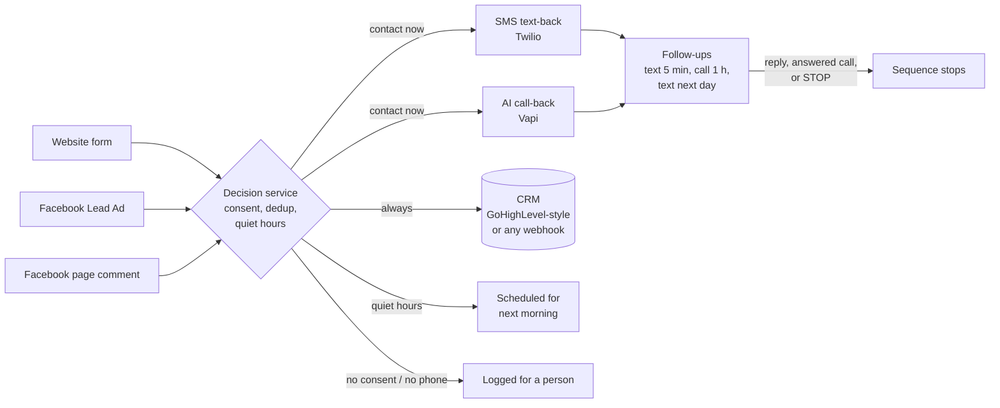

# Speed-to-Lead Automation

[](https://github.com/birneyj1218/speed-to-lead-automation/actions/workflows/ci.yml)
[](https://github.com/birneyj1218/speed-to-lead-automation/actions/workflows/secret-scan.yml)

**Reply to every new lead within seconds, day or night, without anyone picking up a phone.**

Someone fills out your website form or a Facebook lead ad. Before they have closed the tab, they get a friendly text from your business and a phone call from an AI assistant that answers their questions and books the next step. The lead shows up in your CRM at the same moment. If they don't pick up, the system follows up on its own: another text in 5 minutes, another call in an hour, a last text the next day. It stops the moment they reply, answer, or text STOP. It never texts anyone at 11 pm, and it never contacts the same person twice for one inquiry.

There is also a **database reactivation** mode: give it a list of old leads and it texts them in slow, rate-limited batches, skipping anyone who opted out or never gave consent.

## The result

In my client work in 2024, contacting leads immediately instead of after 2 hours increased lead response by 30%.

That is the whole idea of this repo: the lead is most interested in the minute they ask, so the first touch should happen in that minute, every time, including evenings and weekends.

## How it works



Two parts, kept separate on purpose:

- **n8n workflow** ([`n8n/speed-to-lead.json`](n8n/speed-to-lead.json)) handles the plumbing: webhooks in, HTTP calls out to the SMS, voice, and CRM providers.
- **Decision service** ([`src/`](src/)) holds every rule: consent, quiet hours, business hours, dedup, follow-up timing, retries, STOP handling, reactivation pacing. It is plain Node.js with no dependencies, covered by unit and integration tests.

Keeping the rules out of the workflow means they can be tested, and the same rules can drive n8n, Make.com ([walkthrough](docs/make-com-scenario.md)), or plain Node. More in [docs/architecture.md](docs/architecture.md).

## Try it locally (no accounts needed)

Requires Node.js 20 or newer. Everything below runs against a mock server that mimics the Twilio, Vapi, GoHighLevel and Facebook Graph endpoints, so nothing is sent anywhere.

```bash
git clone https://github.com/birneyj1218/speed-to-lead-automation.git
cd speed-to-lead-automation
npm test        # no install step: there are no dependencies
npm run demo    # walks several leads through a simulated day
```

Demo output (simulated clock, fictional business "Blue Gable Roofing"):

```
Tue 10:00 AM     website lead Dana -> contact; sms + call in 84 ms
Tue 10:00 AM     website lead Dana -> duplicate (same contact within 1440 minutes); no outreach
Tue 10:05 AM     follow-up due: sms (text-5m)
Tue 10:05 AM     call-back outcome: no answer, sequence continues
Tue 11:00 AM     follow-up due: call (call-1h)
Tue 11:00 AM     lead replied by text -> sequence stopped, flagged for a human
Tue 10:30 PM     website lead Morgan -> deferred (quiet_hours); no outreach
Wed 9:00 AM      follow-up due: sms (instant-text), call (instant-call)
Wed 9:00 AM      STOP received -> opted_out; reply: "You're unsubscribed from Blue Gable Roofing texts. ..."
Wed 9:00 AM      website lead Casey -> log_only (no_consent); no outreach
Wed 9:00 AM      facebook_comment lead Jordan -> log_only (no_phone); no outreach
Wed 9:00 AM      reactivation: 2 scheduled, skipped: old-3=no_consent, old-4=opted_out, old-5=duplicate, ...
```

### With n8n

```bash
cp .env.example .env          # defaults point at the mock server
npm run mock                  # terminal 1: mock providers on :4010
npm start                     # terminal 2: decision service on :3030
docker compose up -d          # n8n on http://localhost:5678
```

Both Node processes read `.env` automatically (`HOST=0.0.0.0` there lets the n8n container reach them).

1. In n8n, **Workflows > Import from File** and pick `n8n/speed-to-lead.json`.
2. Create the credentials listed in [docs/n8n-workflow.md](docs/n8n-workflow.md) and select them on the HTTP nodes (any placeholder values work against the mock).
3. Activate the workflow and send a test lead:

```bash
curl -X POST http://localhost:5678/webhook/speed-to-lead/website \
  -H 'Content-Type: application/json' -d @examples/website-lead.json
```

The mock server prints the text and the call it received; `curl localhost:4010/_log` shows everything.

### Going live

Change the base URLs in `.env` to the real APIs (listed in `.env.example`), put real keys in the n8n credentials, point the Twilio number's incoming-message webhook and the Vapi assistant's server URL at the workflow, and subscribe your Facebook Page to `leadgen` and `feed` events. Run the decision service somewhere n8n can reach, with `STATE_FILE` set so it survives restarts and `DECISION_API_KEY` set so only n8n can call it.

## Configuration

Business rules live in one JSON file ([`config/blue-gable-roofing.json`](config/blue-gable-roofing.json)), selected with `CONFIG_PATH`.

| Setting | Default | What it does |
|---|---|---|
| `business.timezone` | `America/Chicago` | All hours below are in this time zone |
| `contactWindow` | every day, 09:00 to 20:00 | Outside this is **quiet hours**: nothing is sent; outreach moves to the next opening |
| `businessHours` | Mon to Fri, 08:00 to 17:00 | Picks the first-text wording and which voice assistant calls (live-transfer vs. after-hours) |
| `requireConsent` | `true` | No SMS/call consent on the lead means CRM only, no automated outreach |
| `dedupWindowMinutes` | `1440` | Same phone or email within this window updates the existing lead, sends nothing new |
| `sequence` | text + call now, text 5 min, call 1 h, text next day | Steps, offsets and channels; the whole sequence shifts if it starts in quiet hours |
| `retry` | 3 attempts, backoff 1/5/15 min | For provider errors; each retry re-checks quiet hours |
| `sms.sendOptOutConfirmation` | `true` | Reply to STOP with a confirmation (turn off if Twilio Advanced Opt-Out already does) |
| `reactivation` | 6 per minute, 200 per day, skip if contacted in last 30 days | Pacing and filters for old-lead batches |
| `templates` | see file | Message wording, with `{{firstName}}`, `{{business}}`, `{{callbackNumber}}` |

Environment variables (base URLs, IDs, provider choice) are documented in [`.env.example`](.env.example).

## Compliance and safety

Automated texts and calls to consumers are regulated (in the US: the TCPA, FCC rules, carrier 10DLC registration, and state laws that can be stricter than federal ones). This project builds in the basic safeguards, but **it is not legal advice**. Have your own counsel review your consent language and use before sending real messages.

What the code does:

- **Consent required.** A lead without an SMS/call consent flag is logged in the CRM for a person and never texted or called automatically. The example form text says consent is not a condition of purchase and mentions automated and AI-assisted calls. Store that text with the lead (`consent_text`).
- **STOP handling.** STOP, UNSUBSCRIBE, CANCEL, END, QUIT, STOPALL, REVOKE and OPT OUT, plus plain-English requests like "please stop texting me" or "remove me", opt the number out at once. Every pending step is canceled and future leads from that number are suppressed until the person texts START. When unsure, it treats the message as an opt-out.
- **Quiet hours.** Nothing goes out outside the contact window (default 9 am to 8 pm, narrower than the common 8 am to 9 pm federal limit). Deferred messages are sent at the next opening, never dropped and never sent late at night.
- **No double contact.** Dedup across sources and channels, and reactivation skips anyone already in an active sequence.
- **AI calls.** The voice assistant should say it is an automated assistant calling on behalf of the business. Configure that in the provider's assistant prompt.

What you still need to handle: 10DLC brand and campaign registration, recipient-time-zone checks if you serve several time zones (the rules use the business's zone), state-specific rules (some states limit the number of attempts or restrict Sundays and holidays), consent records for old leads before reactivation, and record retention.

## Limitations

- **One business per instance.** Multi-location or agency use needs a config per location and a real database instead of the JSON-file store.
- **Business time zone only.** Quiet hours use the business's time zone, not each lead's. Add an area-code or address lookup if leads come from far away.
- **The n8n workflow is generated and structurally tested, not run in CI.** CI checks that every node is connected and that no credentials or hosts are embedded. A live import test is a manual step.
- **Facebook signature verification** is implemented in `src/normalize.js` but not wired into the n8n webhook (see [docs/n8n-workflow.md](docs/n8n-workflow.md)).
- **In-flight steps.** If n8n crashes after sending but before reporting the result, that step stays `dispatched`; there is no automatic sweep for it yet.
- **Provider adapters** cover Twilio (SMS), Vapi (voice) and a GoHighLevel-style contact upsert. Field names and API versions should be checked against your own accounts before going live.

## Project layout

```
n8n/speed-to-lead.json       importable n8n workflow
src/engine.js                decision engine (sequence, dedup, consent, retries, STOP)
src/rules.js                 business hours, quiet hours, next allowed time (DST-safe)
src/reactivation.js          rate-limited batch planner
src/normalize.js             website form, Facebook Lead Ads, page comments
src/server.js                decision service HTTP API
src/adapters/                Twilio SMS, Vapi voice, GoHighLevel-style and webhook CRM
mock/server.js               fake Twilio / Vapi / CRM / Graph endpoints for local runs
config/                      business rules and message templates
docs/                        architecture, n8n setup, Make.com walkthrough
test/                        node:test suites
```

## License

MIT. See [LICENSE](LICENSE). All business names, people and phone numbers in this repo are fictional (phone numbers use the reserved 555-01xx range).

---

Built by Jim Birney. [evolvaiagents.com](https://evolvaiagents.com) · [Watch the after-hours call demo](https://evolvaiagents.com/review/n8n-after-hours-call-report-upwork.mp4)
