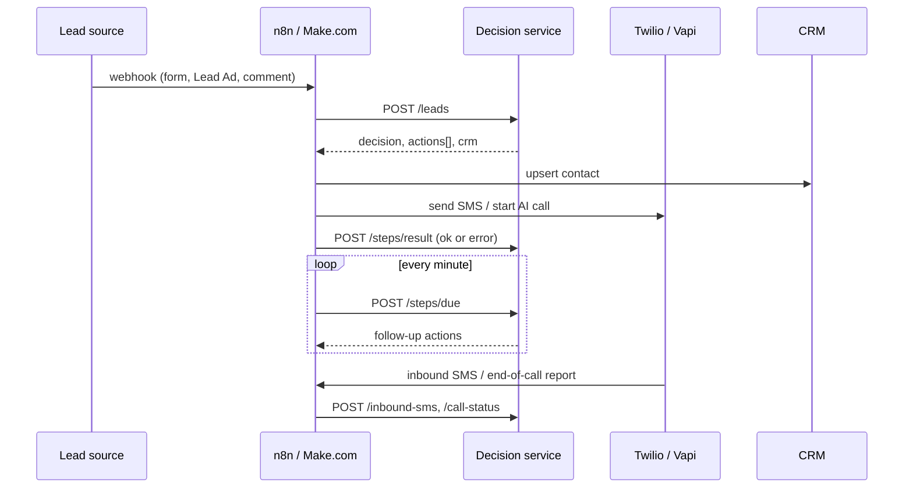

# Architecture

The design splits **rules** from **plumbing**.

- **Decision service** (`src/`, Node.js, no dependencies). Owns every rule: consent, quiet hours, business hours, dedup, the follow-up sequence, retries, STOP handling, reactivation pacing. It never calls a provider. It answers "what should happen now?" with a list of actions.
- **Orchestrator** (n8n workflow, or a Make.com scenario). Receives webhooks, asks the decision service, carries out the actions with HTTP calls to Twilio / Vapi / the CRM, and reports each result back.

The rules can be unit-tested without n8n, and the orchestrator can be swapped (n8n, Make.com, or `src/dispatch.js` in plain Node) without touching them.

## Lead lifecycle

| Status | Meaning |
|---|---|
| `in_sequence` | Has consent and a phone number; steps are scheduled |
| `replied` | Texted back with a real message; sequence stopped, a human takes over |
| `contacted` | Answered the AI call-back; sequence stopped |
| `opted_out` | Sent STOP (or similar); every pending step canceled, future leads from that number suppressed |
| `needs_review` | No consent or no phone number; logged in the CRM, no automated outreach |
| `reactivation` | Old lead in a reactivation batch |

Each sequence step moves `pending -> dispatched -> sent` (or `failed` after the retry limit). Steps can also end `canceled` (lead stopped) or `skipped` (stale after downtime and superseded by a newer step on the same channel).

## Decisions for a new lead

1. Normalize the payload (`src/normalize.js`): name, E.164 phone, email, consent flag.
2. Dedup on phone (then email): a repeat within `dedupWindowMinutes` updates the existing lead and sends nothing new.
3. No phone, or no consent while `requireConsent` is true: `log_only`.
4. Number on the opt-out list: `suppressed`.
5. Otherwise schedule the sequence. If the contact window is open, the first steps come back immediately as actions (`contact`); if not, the whole sequence shifts to the next opening (`deferred`).

## Timing rules

- `contactWindow` decides *whether* to contact. Outside it is quiet hours. Nothing is dropped, only moved to the next opening (DST-safe; tested across the November change).
- `businessHours` decides *how*: which first-text wording and which voice assistant (one that can offer a live transfer vs. an after-hours assistant that takes details).
- The sequence is anchored to the first allowed moment, so a lead that arrives at 10:30 pm gets its 5-minute follow-up at 9:05 am, not three texts at 9:00.
- If several steps on one channel are due at once, only one goes out; the others wait `minGapMinutes` (default 5), and steps more than `staleAfterMinutes` (default 30) overdue are skipped in favor of the newest one.
- Failed sends are retried with backoff (`retry.backoffMinutes`), and each retry is checked against quiet hours again.

## Adapter interfaces

Every provider sits behind a three-method interface, so swapping vendors is one file:

| Interface | Method | Included |
|---|---|---|
| SMS | `send({ to, body }) -> { id }` | `twilio-sms.js`, `memory.js` |
| Voice | `startCall({ to, assistant, variables }) -> { id }` | `vapi-voice.js`, `memory.js` |
| CRM | `upsertLead(crmPayload) -> { id }` | `crm-gohighlevel.js`, `crm-webhook.js`, `memory.js` |

HTTP calls retry on network errors, 429 and 5xx with exponential backoff, and never on other 4xx.

## State

`MemoryStore` for tests and the demo; `FileStore` writes one JSON file atomically (`STATE_FILE`). That is fine for one business and a few thousand leads. For more, implement the same small store surface on Postgres or Redis.
